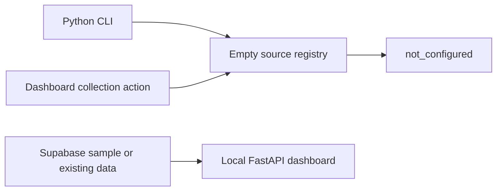
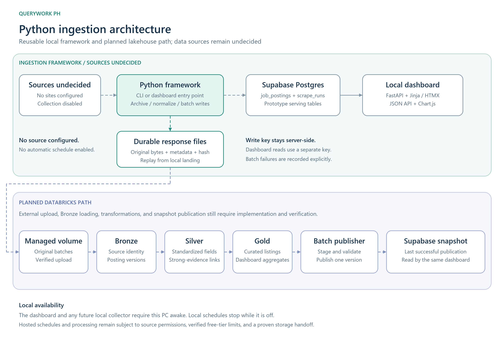

# QueryWork PH

A personal data engineering project for collecting job listings, preserving source data, and exploring hiring trends, skill demand, and advertised compensation. The goal is Philippine labor-market analysis; the current prototype does not establish nationwide coverage.

## Current implementation

The working application lives in [`goodjob/`](goodjob/README.md). It contains a pure Python ingestion framework and a local FastAPI dashboard backed by Supabase PostgreSQL. Jinja2 renders HTML, HTMX refreshes filtered sections, and Chart.js draws the charts. **No ingestion source has been selected. The source registry is empty, and live collection and replay are disabled.**



The CLI and dashboard collection action report `not_configured` before making any ingestion HTTP request or database write, even when a write credential exists. Selecting and implementing a source adapter is a separate future decision. Illustrative seed rows remain available to demonstrate the dashboard and are not verified vacancies or a selected data source.

The framework includes original-byte preservation, metadata/checksums, retries, normalization helpers, replay, batched publication, and run reporting. These mechanisms are tested using isolated fixtures; they do not imply that a live source is available. The dashboard can read sample or existing records independently. Databricks lakehouse processing and atomic Gold publication are not implemented.

## Target architecture

The [architecture document](docs/architecture.MD) starts with source selection and an explicitly implemented adapter. After that gate, the planned path is Python collection, verified upload to a Databricks managed volume, Bronze loading, Silver standardization, Gold modeling, and a validated Supabase snapshot. The future dashboard publication will remain separate from Databricks compute availability.



- [Bronze ingestion plan](docs/BRONZE_INGESTION_PLAN.md): prove original-response upload and replay into Databricks.
- [Python with GitHub Actions](docs/PYTHON_GITHUB_ACTIONS_INGESTION.md): a proposed execution environment, with billing and source-access gates before scheduling.
- [Startup guide](docs/STARTUP.md): run the dashboard and inspect the source-disabled Python CLI.

Databricks upload, Bronze/Silver/Gold processing, cloud execution, and automated schedules remain planned until implemented and verified. Source selection for Philippine market coverage remains open.

## Repository structure

```text
Jobless/
├── goodjob/
│   ├── app/                  # FastAPI routes, services, schemas, templates, charts
│   ├── ingestion/            # Source-disabled Python ingestion framework and CLI
│   ├── supabase/migrations/  # Current dashboard database schema and analytics SQL
│   ├── tests/                # Offline unit checks and explicit live checks
│   ├── requirements.txt
│   ├── .env.example
│   ├── Dockerfile            # Optional local container packaging
│   ├── docker-compose.yml
│   └── README.md
├── docs/                     # Architecture, plans, diagrams, operating instructions
├── database/schema.sql       # Earlier prototype schema; not the dashboard migration
└── AGENTS.md                 # Project budget and documentation rules
```

The detailed [application guide](goodjob/README.md#code-structure-and-modularity) explains where each responsibility belongs. The `ingestion/` package shown above is inside `goodjob/`; planned Databricks notebooks are not presented as implemented repository directories.

## Run locally

Use Python 3.11 or later. In the existing Windows workspace:

```powershell
cd C:\Devs\Jobless
.\.venv\Scripts\python.exe -m pip install -r .\goodjob\requirements.txt
# On first setup only, copy goodjob/.env.example to goodjob/.env and configure it.
cd goodjob
..\.venv\Scripts\python.exe -m uvicorn app.main:app --host 127.0.0.1 --port 8000 --reload
```

Open <http://127.0.0.1:8000/>. The [startup guide](docs/STARTUP.md) covers creating the Python environment and configuring credentials. A read key is sufficient for the dashboard. A write key alone cannot enable ingestion: no sources are selected or implemented. The Python framework uses the existing dependencies and needs no separate automation service.

## Zero recurring cost

The project must remain within verified free service allowances and local resources. The dashboard and local collection run only while the computer is awake and their processes are running. No automatic schedule is enabled by these setup steps.

Keep the Supabase organization on its Free plan and measure database and egress usage. Databricks work must use Free Edition rather than an expiring trial, and must tolerate compute quota shutdowns and restricted outbound access. Before adopting hosted scheduling, confirm repository visibility, account allowances, and that billable overage is blocked. See the constraints and verification steps in the architecture and execution plans.

## Intended analytics

- Regional demand comparisons require explicit Philippine location and eligibility rules.
- Skill-demand charts use canonical technology tags extracted from the observed listings.
- Compensation analysis must disclose salary sample size, original currency/pay period, and conversion assumptions. The current dashboard uses annual USD posting midpoints; monthly PHP regional benchmarks remain future work.
- Posting-volume trends describe the collected sample and publication dates, not all employers or actual completed hires.

## Author

Peja Lattrell Escares — [portfolio](https://pejalattrell.online)

