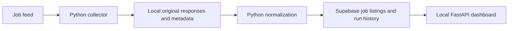

# QueryWork PH

A personal data engineering project for collecting job listings, preserving source data, and exploring hiring trends, skill demand, and advertised compensation. The goal is Philippine labor-market analysis; the current prototype does not establish nationwide coverage.

## Current implementation

The working application lives in [`goodjob/`](goodjob/README.md). It uses a pure Python ingestion package and a local FastAPI dashboard backed by Supabase PostgreSQL. Jinja2 renders HTML, HTMX refreshes filtered sections, and Chart.js draws the charts. The same Python collector can run from the command line or the dashboard's **Run Scraper Now** action.



The current source adapters target Remotive's bounded software-development feed and Arbeitnow's first feed page. These are prototype inputs, not a complete Philippine vacancy census. Confirm each source's collection and reuse terms, request allowance, and geographic eligibility before running live collection. Illustrative seed rows are labeled in the dashboard and must not be treated as verified vacancies.

The ingestion path saves original response bytes and metadata locally before parsing or normalizing them. Supabase contains the normalized listings and ingestion-run status used by the existing dashboard. This direct publication is the current prototype; it does not implement the Databricks lakehouse pipeline or an atomic Gold snapshot publisher.

## Target architecture

The [architecture document](docs/architecture.MD) describes the next stage: reuse Python collection, upload originals into a Databricks managed volume, load Bronze, standardize and link postings in Silver, build Gold data, then publish a validated snapshot to Supabase. The local dashboard reads the latest successful publication independently of Databricks compute availability.


- [Bronze ingestion plan](docs/BRONZE_INGESTION_PLAN.md): prove original-response upload and replay into Databricks.
- [Python with GitHub Actions](docs/PYTHON_GITHUB_ACTIONS_INGESTION.md): a proposed execution environment, with billing and source-access gates before scheduling.
- [Startup guide](docs/STARTUP.md): run the current application and Python collector.

Databricks upload, Bronze/Silver/Gold processing, cloud execution, and automated schedules remain planned until implemented and verified. Source selection for Philippine market coverage remains open.

## Repository structure

```text
Jobless/
├── goodjob/
│   ├── app/                  # FastAPI routes, services, schemas, templates, charts
│   ├── ingestion/            # Python collection, raw preservation, normalization, CLI
│   ├── supabase/migrations/  # Current dashboard database schema and analytics SQL
│   ├── tests/                # Offline unit checks and explicit live checks
│   ├── requirements.txt
│   ├── .env.example
│   ├── Dockerfile            # Optional local container packaging
│   ├── docker-compose.yml
│   └── README.md
├── docs/                     # Architecture, plans, diagrams, operating instructions
├── database/schema.sql       # Earlier prototype schema; not the dashboard migration
├── research/                 # Exploratory notes and saved feed examples
└── AGENTS.md                 # Project budget and documentation rules
```

The detailed [application guide](goodjob/README.md#code-structure-and-modularity) explains where each responsibility belongs. The `ingestion/` package shown above is inside `goodjob/`; planned Databricks notebooks are not presented as implemented repository directories.

## Run locally

Use Python 3.11 or later. In the existing Windows workspace:

```powershell
cd C:\Devs\Jobless
.\.venv\Scripts\python.exe -m pip install -r .\goodjob\requirements.txt
# On first setup only, copy goodjob/.env.example to goodjob/.env and configure it.
cd goodjob
..\.venv\Scripts\python.exe -m uvicorn app.main:app --host 127.0.0.1 --port 8000 --reload
```

Open <http://127.0.0.1:8000/>. The [startup guide](docs/STARTUP.md) covers creating the Python environment and configuring credentials. A read key is sufficient for the dashboard; ingestion also requires a server-only write key. Python ingestion uses the same installed Python dependencies and needs no separate automation service.

## Zero recurring cost

The project must remain within verified free service allowances and local resources. The dashboard and local collection run only while the computer is awake and their processes are running. No automatic schedule is enabled by these setup steps.

Keep the Supabase organization on its Free plan and measure database and egress usage. Databricks work must use Free Edition rather than an expiring trial, and must tolerate compute quota shutdowns and restricted outbound access. Before adopting hosted scheduling, confirm repository visibility, account allowances, and that billable overage is blocked. See the constraints and verification steps in the architecture and execution plans.

## Intended analytics

- Regional demand comparisons require explicit Philippine location and eligibility rules.
- Skill-demand charts use canonical technology tags extracted from the observed listings.
- Compensation analysis must disclose salary sample size, original currency/pay period, and conversion assumptions. The current dashboard uses annual USD posting midpoints; monthly PHP regional benchmarks remain future work.
- Posting-volume trends describe the collected sample and publication dates, not all employers or actual completed hires.

## Author

Peja Lattrell Escares — [portfolio](https://pejalattrell.online)

