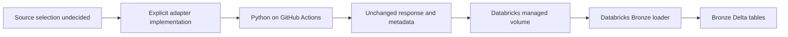

# Python ingestion with GitHub Actions

Feasibility assessment checked on 9 November 2026; execution plan updated on 16 November 2026 to reuse the Python framework. No job sites or other sources are selected, and the registry in `goodjob/ingestion/` is empty. Collection and replay are disabled before ingestion HTTP or writes. GitHub execution, Databricks upload, Bronze loading, and hosted scheduling remain proposed and have not been enabled.

This source-neutral proposal starts with an explicit source decision and a tested adapter; it selects no provider or endpoint. Only after those gates would Python plus GitHub Actions be a candidate for execution independently of the local PC. Python would perform collection, validation, and upload; Actions would supply the execution environment. First prove a manual run and verified storage, then consider a schedule after source limits, measured usage, and zero-cost billing controls are known.

This moves source fetching outside Databricks Free Edition's restricted outbound network. Actual source access from GitHub still needs testing: a source can restrict cloud-hosted clients or impose request limits. Uploading files is a separate milestone from loading Bronze tables. The latter still uses Databricks compute and remains subject to Free Edition availability and usage limits. [Free Edition limits](https://docs.databricks.com/aws/en/getting-started/free-edition-limitations)

The existing dashboard remains local. Its availability still depends on the PC, even if cloud collection continues while the PC is off.

**Cost and scheduling constraints**

| Component | Verified constraint | Choice for this project |
| --- | --- | --- |
| Actions compute in a public repository | Standard GitHub-hosted runners have free compute independently of the account's included compute usage. | Use a standard Linux runner if the repository is already public or public code is acceptable. |
| Actions compute in a private repository | GitHub Free currently includes $12/month of shared compute usage, rather than a fixed minute quota. Other eligible usage draws from it too. | Confirm the account allowance and billing controls, then measure total job duration. |
| Actions storage | GitHub Free includes 500 MB of artifact storage; caches have a separate 10 GB allowance per repository. | Keep originals in the Databricks volume. A cache is unnecessary for the first proof. |
| Billing controls | Without a valid payment method, over-quota usage is blocked. With a payment method, account budgets need checking. | Verify that billable overage is blocked before scheduling. |
| Databricks destination | Free Edition includes default storage and quota-limited compute; it is intended for personal, non-commercial use. | Use an existing managed volume in a verified Free Edition workspace. Measure raw-data growth. |

Sources: [GitHub Actions billing](https://docs.github.com/en/billing/concepts/product-billing/github-actions), [Databricks Free Edition](https://docs.databricks.com/aws/en/getting-started/free-edition).

The Files API documentation has a general data-transfer billing caveat. Its availability and cost must be checked in the actual Free Edition workspace; the API should not be described as universally free. No extra cloud account or storage service is proposed here. [Files API](https://docs.databricks.com/api/files/v2/file)

Schedules run from the default branch. GitHub can delay scheduled runs and drop queued runs during sufficiently high load. Public-repository schedules are disabled after 60 days without repository activity. An eight-hour interval at minute 17 is a reasonable candidate after checking source limits, but should not be treated as an exact-time guarantee. Manual dispatch should be available for recovery. [Schedule behavior](https://docs.github.com/en/actions/reference/workflows-and-actions/events-that-trigger-workflows#schedule)

For scale only: three five-minute executions per day would total 465 runner-minutes in a 31-day month. This is an estimate, not a measured duration or billing guarantee. Three 2 MiB batches per day would add approximately 186 MiB of raw storage that month. Retries, more sources, and manual runs increase both totals. Choose retention after measuring real batch sizes.

**Storage handoff**

Each hosted job gets a fresh machine. Files left there do not form persistent ingestion storage. Actions artifacts expire and consume storage allowance, so they should not be the only copy of originals. A temporary recovery artifact is optional only after confirming storage budget and source redistribution terms. [Hosted runners](https://docs.github.com/en/actions/how-tos/manage-runners/github-hosted-runners/use-github-hosted-runners), [Artifact retention](https://docs.github.com/en/repositories/managing-your-repositorys-settings-and-features/enabling-features-for-your-repository/managing-github-actions-settings-for-a-repository)

The smallest proposed handoff uses Databricks Files API 2.0 to upload and download a small file under `/Volumes/<catalog>/<schema>/<volume>/...`. The API accepts raw bytes. Set `overwrite=false` explicitly, download the result, and compare its SHA-256 with the original. A conflicting existing file must be verified before it is treated as the same saved response. The API is documented as Public Preview. [Files API reference](https://docs.databricks.com/api/files/v2/file)

The volume must already exist. Its identity needs catalog/schema access and volume write permission; read permission is needed for verification. A workspace personal access token is a candidate for the first proof, provided the workspace permits its creation and the required API calls. Store credentials in Actions Secrets, with an expiry and a rotation plan. Free Edition lacks account-console and account-level API access; general workspace API documentation does not by itself prove this account's authentication capabilities. [Volume operations](https://docs.databricks.com/aws/en/volumes/volume-files), [Workspace tokens](https://docs.databricks.com/aws/en/dev-tools/auth/pat), [Actions Secrets](https://docs.github.com/en/actions/how-tos/write-workflows/choose-what-workflows-do/use-secrets)

The hosted runner must connect directly to the source and Databricks. It cannot use the PC's `127.0.0.1` FastAPI endpoint or rely on the local raw archive. A successful local CLI run does not prove that this hosted handoff works.

**Proposed implementation**

| Addition | Responsibility |
| --- | --- |
| Existing `goodjob/ingestion/runner.py` | Source-disabled framework. After explicit adapter implementation, reuse fixture-tested preservation, metadata/checksums, retries, replay, and batch mechanisms. Publication helpers do not imply live ingestion or Bronze loading. |
| Planned Python volume uploader | Save body and metadata to the managed volume, verify readback, and write a completion manifest last. |
| Planned collector dependency manifest | Pin only the tested hosted-collection dependencies; avoid unnecessary dashboard dependencies on the runner. |
| Existing `goodjob/tests/` plus uploader tests | Reuse fixtures and HTTP mocks for preservation, normalization, retries, and replay; add upload failure/readback checks. |
| `.github/workflows/collect.yml` | Start with manual dispatch, one collection at a time, a bounded timeout, and read-only repository permissions. Add the schedule after proof. |
| `databricks/01_bronze_ingestion/` | Read completed batches into Bronze and maintain collection history using the existing Bronze plan. |

Only the source-disabled Python framework and isolated fixture tests currently exist. A source adapter, uploader, hosted dependency manifest, Actions workflow, and Databricks loader remain proposed. Existing `httpx` and HTTP-mock patterns can be reused. Generic normalization belongs after raw preservation and must not replace the Bronze contract. Keep the eventual collector independent of its execution environment instead of maintaining a second source-fetch implementation.

Each batch should include its collection ID, source, sanitized request details, retrieval time, response status/content type, checksum, and validation outcome. Keep source publication times distinct from collection time. A completed upload must not be recorded as a completed Bronze load.

Retries within an execution should reuse the saved body. Re-running processing should inspect durable batch state before collecting again. If a job ends before any durable copy exists, another source request may be necessary; an ephemeral runner cannot guarantee recovery of unsaved bytes. A completion manifest lets the loader ignore partial batches. Run IDs and request IDs should make repeated saving safe, while a new scheduled collection keeps its own observation.

Temporary network failures and rate limits should receive bounded retries that respect `Retry-After`. Invalid credentials and invalid requests need a clear failure result. Keep the last successful dashboard snapshot visible with its actual refresh time. A failed collection remains a failure in operational history; it should not be marked successful merely to keep Actions green.

The current dashboard collection action reports `not_configured` because no sources are selected; no Python writer task is started. It does not dispatch to GitHub. After explicit source/adapter implementation, a hosted proof would use GitHub's manual-run interface. Remote dispatch from FastAPI would require a separate server-side integration. Any future local/hosted publication needs a shared coordination rule.

**Proof before scheduling**

1. Explicitly decide a permitted source and implement/test its adapter. No source is selected by this document. Then confirm repository visibility, default branch, Actions policy, and account billing controls. The remote is `PejaLattrell/QueryWork-PH`, but visibility and billing were not verified in this assessment.
2. Confirm Databricks Free Edition, a target managed volume, and unattended workspace authentication.
3. Upload a tiny harmless fixture from an external client, download it, and verify its hash. Repeat the save without replacing a different file.
4. Read the fixture from a Databricks notebook and prove the Bronze write can be replayed safely.
5. Choose one permitted source, check its terms/request limits, and run one real response through collection and storage.
6. Run the same route manually on GitHub. Prove that raw files and history survive the runner ending, and that a failed upload is visible and recoverable.
7. Enable a conservative schedule, inspect the first scheduled completion, and document how to retry and pause it.

No source collection, account/secret changes, workflow publication, or GitHub schedule was performed during the feasibility assessment. The local Python implementation adds no hosted schedule. Open gates remain source approval, repository/account settings, and a verified Databricks authentication/upload/Bronze path.
