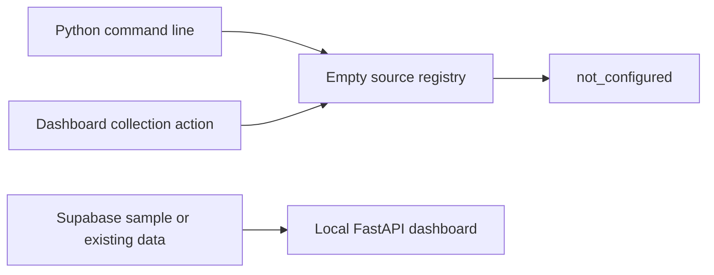
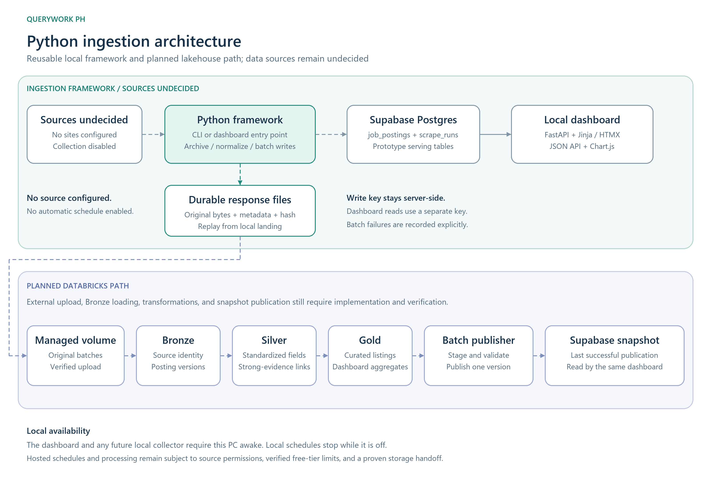

# QueryWork PH architecture

This personal project has a zero recurring service fee requirement. Python provides the ingestion framework. No job sites or other sources have been selected, the source registry is empty, and collection/replay are disabled. Framework mechanisms, dashboard reads, and planned Databricks work have different completion states and are shown separately.

## Current implementation

The framework is in `goodjob/ingestion/`, with CLI and application entry points. Its preservation, retry, normalization, replay, batch-publication, and run-history mechanisms are exercised by isolated fixtures. No live adapter is configured. Both collection and replay stop before ingestion HTTP or database writes; a server-only write key cannot bypass that gate. Dashboard reads continue independently.

Source selection is undecided. Before enabling ingestion, explicitly select a permitted input, establish its collection/reuse terms and request limits, and implement/test its adapter. No provider or endpoint is recommended by this architecture. Synthetic `source=seed` rows remain labeled dashboard examples, not a source selection or evidence of Philippine market coverage.

The current application and CLI report `not_configured` for collection requests because the registry is empty. The framework can own one local background task per app process after the source-selection/adapter gate is completed. Future CLI and app collection must not run simultaneously without a shared lock. No automatic schedule is installed or enabled. Local processes and archives depend on the computer being awake and available.

## Planned lakehouse path

```mermaid
flowchart LR
    Select[Source selection undecided] --> Adapter[Explicit adapter implementation]
    Adapter --> Collect[Python collector]
    Collect --> Raw[Original response and metadata]
    Raw --> Upload[Verified Python upload]
    Upload --> Landing[Databricks managed volume]
    Landing --> Bronze[Bronze Delta]
    Bronze --> Silver[Silver Delta]
    Silver --> Gold[Gold marts]
    Gold --> Publish[Validated snapshot publication]
    Publish --> DB[Supabase Free Postgres]
    DB --> App[Local FastAPI dashboard]
```

The editable diagram is [architecture.svg](architecture.svg), generated together with the PNG by `scripts/render_architecture.py`. The image and this document must change together when architecture changes. To regenerate from the repository root, install the optional local rendering dependency with `.\.venv\Scripts\python.exe -m pip install -r scripts/requirements-diagrams.txt`, then run `.\.venv\Scripts\python.exe scripts/render_architecture.py`.

Databricks upload, Bronze loading, Silver/Gold processing, and the snapshot publisher remain planned. A local raw archive is not a completed Bronze load. A completed file upload is not proof that the Bronze table contains that batch.

## Ingestion and execution

Keep collection logic in Python independently of where it executes. First select a permitted input and implement its adapter; only then prove a manual collection. For the Databricks milestone, verify workspace authentication, upload/readback of a tiny fixture, and a replayable Bronze write before collecting live data through that route.

If Python can reach an authorized source from a Databricks Free Edition notebook, Lakeflow Jobs is a possible future scheduler. Free Edition restricts outbound domains and compute usage, so source access and a measured run are gates rather than assumptions. If collection runs locally, preserve the raw archive until upload and the table write have been verified. A local schedule stops doing useful work while the PC is off or asleep.

GitHub Actions is a separate proposed execution environment for the same Python collector. No hosted workflow or schedule is enabled. Confirm its source access, durable storage handoff, account allowance, and blocked billable overage first. See the [execution proposal](PYTHON_GITHUB_ACTIONS_INGESTION.md).

## Posting identity and observations

- The generic Python normalization/identity helpers are exercised with synthetic records. A future adapter must supply an explicit source identity and stable external job ID. Distinct vacancies with the same company/title should remain distinct; the database `fingerprint` field can hold their deterministic SHA-256 identity.
- For the planned Bronze postings, add a stable content hash to source/job identity to distinguish meaningful versions. Exclude retrieval timestamps and tracking parameters from that content hash.
- Keep retrieval times, source publication times, collection attempts, and posting versions separate. Repeated collection is an observation even when the posting content is unchanged.
- Preserve original batches for replay. Skipping duplicate Bronze rows does not reduce raw landing storage; measure actual growth and define retention before unattended operation.
- Silver standardizes fields and links cross-source listings using strong evidence, such as an employer requisition ID or canonical application URL. Keep uncertain matches separate.
- A missing listing in a bounded feed does not prove that the vacancy closed. Define explicit lifecycle and historical-count rules before publishing market trends.

## Serving and publication

The current FastAPI app uses shared validated filters and Supabase SQL functions to assemble cards, charts, and listings from sample or existing records. The database client uses a read key. The optional server-only write key does not activate the empty ingestion registry. Task ownership and cooldown mechanisms are local to one app process and are tested with fixture-configured runners.

The framework's direct-to-serving publication mechanism is not an atomic Gold snapshot: with an explicitly configured adapter, earlier successful batches could remain visible if a later batch fails. That behavior is tested with isolated fixtures and is separate from the future snapshot publisher.

The future publisher will stage and validate the fields and aggregates FastAPI needs, then make a complete snapshot visible with a publication ID and last-successful-refresh timestamp. Dashboard sections must read the same publication. A retry should leave the same result, and a failed publish should leave the previous snapshot available.

Test the Gold-to-Supabase handoff with a small batch. If outbound access prevents a Databricks push, verify a Python publisher that pulls the result and writes it to Supabase. A local publisher depends on the computer being on. Published data remains separate from Databricks compute availability, subject to the serving service's own limits.

## Free service limits and recovery

- Databricks Free Edition is for personal non-commercial work. It has restricted outbound access, quota-limited compute, and no uptime guarantee. Quota exhaustion can suspend compute for the day or, in extreme cases, the month. [Free Edition limits](https://docs.databricks.com/aws/en/getting-started/free-edition-limitations)
- Supabase Free currently includes a 500 MB database, 5 GB uncached egress, and up to two active projects. Free projects can pause after a week of inactivity. Keep raw archives outside the serving database, monitor usage, and keep an independent recovery copy. Verify the organization is actually on Free before relying on a zero-cost deployment. [Supabase pricing](https://supabase.com/pricing)
- Preserve originals and metadata before normalization. Keep a saved response when a later write fails; recover from that copy instead of fetching the source again unnecessarily. A stopped process can leave an unfinished collection, so inspect both local run metadata and database run status.

See the [Bronze ingestion plan](BRONZE_INGESTION_PLAN.md), [application guide](../goodjob/README.md), and [local startup guide](STARTUP.md).

