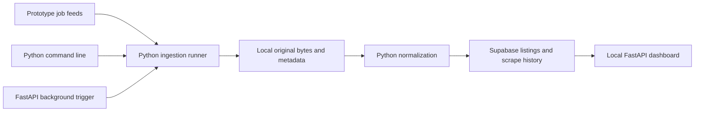

# QueryWork PH architecture

This personal project has a zero recurring service fee requirement. Python owns collection, raw preservation, normalization, and publication. The current local implementation and the planned Databricks pipeline have different completion states and are shown separately.

## Current implementation

The code is in `goodjob/ingestion/`. The runner is reusable from the Python CLI and the application's ingestion service. Raw response preservation happens before parsing. Normalized records are written in bounded batches to the existing `job_postings` table, with status in `scrape_runs`. This is a direct-to-serving prototype: publication can contain successful batches from a run that subsequently fails, and the dashboard reports the latest completed run separately. It is not yet the atomic Gold publication described below.

The source adapters target Remotive and Arbeitnow's bounded recent feeds. Their collection/reuse terms and suitability for Philippine market coverage require validation before live operation. The dashboard's illustrative seed records remain explicitly labeled.

The application starts one local background collection per process when requested. It also supports a separate one-shot CLI run. Use one collection process at a time; do not combine dashboard collection and an external schedule without a shared lock. No automatic schedule is installed or enabled. Local collection, local archives, and the dashboard depend on the computer being awake and the relevant process running.

## Planned lakehouse path

```mermaid
flowchart LR
    Source[Authorized source] --> Collect[Python collector]
    Collect --> Raw[Original response and metadata]
    Raw --> Upload[Verified Python upload]
    Upload --> Landing[Databricks managed volume]
    Landing --> Bronze[Bronze Delta]
    Bronze --> Silver[Silver Delta]
    Silver --> Gold[Gold marts]
    Gold --> Publish[Validated snapshot publication]
    Publish --> DB[Supabase Free Postgres]
    DB --> App[Local FastAPI dashboard]
```

The editable diagram is [architecture.svg](architecture.svg). The image and this document must change together when architecture changes.

Databricks upload, Bronze loading, Silver/Gold processing, and the snapshot publisher remain planned. A local raw archive is not a completed Bronze load. A completed file upload is not proof that the Bronze table contains that batch.

## Ingestion and execution

Keep collection logic in Python independently of where it executes. Start locally with a manual collection. For the Databricks milestone, verify workspace authentication, upload/readback of a tiny fixture, and a replayable Bronze write before collecting live data through that route.

If Python can reach an authorized source from a Databricks Free Edition notebook, Lakeflow Jobs is a possible future scheduler. Free Edition restricts outbound domains and compute usage, so source access and a measured run are gates rather than assumptions. If collection runs locally, preserve the raw archive until upload and the table write have been verified. A local schedule stops doing useful work while the PC is off or asleep.

GitHub Actions is a separate proposed execution environment for the same Python collector. No hosted workflow or schedule is enabled. Confirm its source access, durable storage handoff, account allowance, and blocked billable overage first. See the [execution proposal](PYTHON_GITHUB_ACTIONS_INGESTION.md).

## Posting identity and observations

- The current Python normalizer identifies a listing using its source and stable external job ID. Distinct vacancies with the same company/title remain distinct. The existing database `fingerprint` field stores the resulting deterministic SHA-256 identity.
- For the planned Bronze postings, add a stable content hash to source/job identity to distinguish meaningful versions. Exclude retrieval timestamps and tracking parameters from that content hash.
- Keep retrieval times, source publication times, collection attempts, and posting versions separate. Repeated collection is an observation even when the posting content is unchanged.
- Preserve original batches for replay. Skipping duplicate Bronze rows does not reduce raw landing storage; measure actual growth and define retention before unattended operation.
- Silver standardizes fields and links cross-source listings using strong evidence, such as an employer requisition ID or canonical application URL. Keep uncertain matches separate.
- A missing listing in a bounded feed does not prove that the vacancy closed. Define explicit lifecycle and historical-count rules before publishing market trends.

## Serving and publication

The current FastAPI app uses shared validated filters and Supabase SQL functions to assemble cards, charts, and listings. The database client uses a read key; only ingestion receives the optional server-only write key. The ingestion service's task and cooldown are local to one app process.

The future publisher will stage and validate the fields and aggregates FastAPI needs, then make a complete snapshot visible with a publication ID and last-successful-refresh timestamp. Dashboard sections must read the same publication. A retry should leave the same result, and a failed publish should leave the previous snapshot available.

Test the Gold-to-Supabase handoff with a small batch. If outbound access prevents a Databricks push, verify a Python publisher that pulls the result and writes it to Supabase. A local publisher depends on the computer being on. Published data remains separate from Databricks compute availability, subject to the serving service's own limits.

## Free service limits and recovery

- Databricks Free Edition is for personal non-commercial work. It has restricted outbound access, quota-limited compute, and no uptime guarantee. Quota exhaustion can suspend compute for the day or, in extreme cases, the month. [Free Edition limits](https://docs.databricks.com/aws/en/getting-started/free-edition-limitations)
- Supabase Free currently includes a 500 MB database, 5 GB uncached egress, and up to two active projects. Free projects can pause after a week of inactivity. Keep raw archives outside the serving database, monitor usage, and keep an independent recovery copy. Verify the organization is actually on Free before relying on a zero-cost deployment. [Supabase pricing](https://supabase.com/pricing)
- Preserve originals and metadata before normalization. Keep a saved response when a later write fails; recover from that copy instead of fetching the source again unnecessarily. A stopped process can leave an unfinished collection, so inspect both local run metadata and database run status.

See the [Bronze ingestion plan](BRONZE_INGESTION_PLAN.md), [application guide](../goodjob/README.md), and [local startup guide](STARTUP.md).

